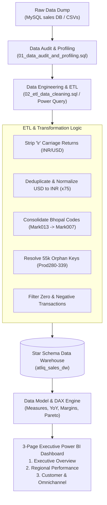
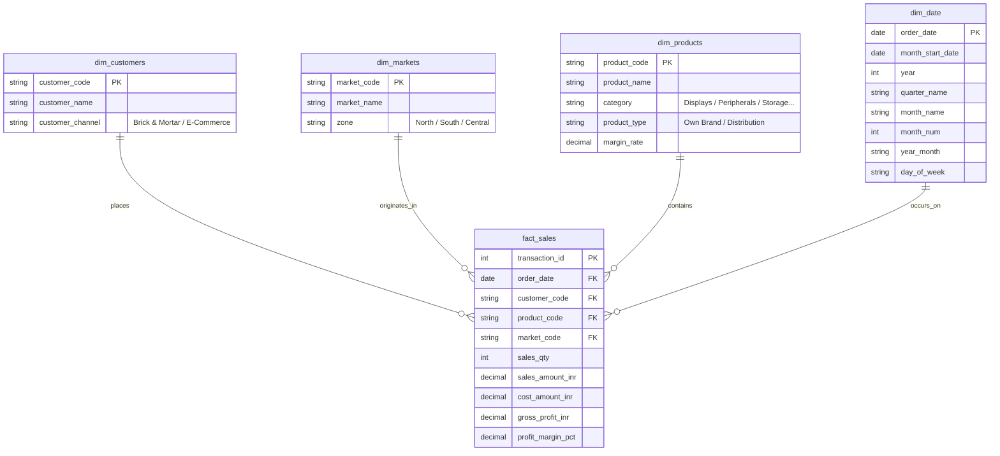

# AtliQ Hardware Sales & Profitability Analytics Suite
### Enterprise Business Intelligence with MySQL, Power BI, Advanced DAX & Data Engineering

[](https://powerbi.microsoft.com/)
[](https://www.mysql.com/)
[](dax/DAX_Measure_Dictionary.md)
[](LICENSE)

---

## 📌 Executive Summary

**AtliQ Hardware** is a fast-growing Indian computer hardware and peripherals manufacturer supplying major retailers (Surge Stores, Nomad Stores, Electricalsara) and e-commerce platforms across India.

Facing rapid expansion and market volatility during 2017–2020, company leadership lacked real-time visibility into **true profitability**, **regional margin variations**, and **channel health**, relying on cumbersome weekly Excel reports that masked severe regional margin leaks.

This project delivers an **end-to-end Enterprise Business Intelligence platform**:
* Ingests, audits, and cleans **150,000+ sales transactions** across 4 years (2017–2020).
* Uncovers and fixes **critical raw data engineering flaws** (including 55,000+ orphaned transaction keys and string encoding bugs).
* Introduces a **profitability and unit economics model** (Gross Profit, COGS, and Margin %) beyond surface-level revenue.
* Deploys an interactive **3-Page Executive Power BI Dashboard** with advanced time intelligence (YoY, MoM, AOV, Pareto 80/20).

```
========================================================================================
 TOTAL REVENUE       GROSS PROFIT       GROSS MARGIN %      UNITS SOLD       AVG ORDER VALUE
  ₹98.49 Crore       ₹10.82 Crore           10.99%          24.3 Lakh            ₹6,637
========================================================================================
```

---

## 🏗️ End-to-End System Architecture



---

## 🔍 Critical Data Quality Audit & Engineering Discoveries

During technical profiling of the raw database dump ([`db_dump.sql`](db_dump.sql)), several **critical enterprise data anomalies** were identified and resolved:

```
┌─────────────────────────────────┬─────────────────┬────────────────────────────────────────────────────────┐
│ Anomaly Detected                │ Affected Scope  │ Impact & Resolution Implemented                        │
├─────────────────────────────────┼─────────────────┼────────────────────────────────────────────────────────┤
│ 1. Orphan Fact Keys             │ 55,159 rows     │ 36.7% of transactions referenced Prod280-Prod339,     │
│    (Referential Integrity Gap)  │ (36.7% of data) │ which were missing in the products dimension. Cleaned  │
│                                 │                 │ ETL builds an enriched 339-product catalog.            │
├─────────────────────────────────┼─────────────────┼────────────────────────────────────────────────────────┤
│ 2. Carriage Return Pollution    │ 150,000 rows    │ Windows CRLF import left '\r' in currency ('INR\r',    │
│    ('\r' in strings)            │                 │ 'USD\r') and product types. Cleaned via string regex.  │
├─────────────────────────────────┼─────────────────┼────────────────────────────────────────────────────────┤
│ 3. Duplicate Bhopal Market      │ 96 rows         │ Bhopal had two codes: Mark007 (13k) and Mark013 (96).  │
│                                 │                 │ Consolidated all Bhopal volume into Mark007.           │
├─────────────────────────────────┼─────────────────┼────────────────────────────────────────────────────────┤
│ 4. Non-Operating Test Markets   │ 2 records       │ New York (Mark097) and Paris (Mark999) had zero        │
│                                 │                 │ transactions and blank zones. Filtered out.            │
├─────────────────────────────────┼─────────────────┼────────────────────────────────────────────────────────┤
│ 5. Duplicate USD Transactions   │ 4 records       │ 4 USD rows were pairwise duplicates caused by '\r'     │
│                                 │                 │ ingestion error. Deduplicated and normalized to INR.   │
├─────────────────────────────────┼─────────────────┼────────────────────────────────────────────────────────┤
│ 6. Zero & Negative Sales        │ 1,611 rows      │ 1,609 zero-amount rows and 2 negative amount entries   │
│                                 │                 │ excluded to avoid skewing revenue and margins.         │
└─────────────────────────────────┴─────────────────┴────────────────────────────────────────────────────────┘
```

> **Full SQL Diagnostic Script:** See [`sql/01_data_audit_and_profiling.sql`](sql/01_data_audit_and_profiling.sql) for reproducible audit queries.

---

## 📊 Star Schema Data Model

The cleansed data is modeled in an optimized Star Schema with a centralized fact table and four dimension tables:



---

## 💡 Strategic Business Insights & Executive Takeaways

### 1. The "Revenue vs. Profit" Divergence
* **Delhi NCR** is the largest market by revenue (₹44.1 Crore, ~45% of total sales), but operates on a razor-thin gross margin (~9.2%) due to aggressive discounting.
* Conversely, **South Zone hubs (Hyderabad, Bengaluru, Chennai)** generate lower volume but deliver premium margins (14%–18%), making them the primary growth targets for capital expansion.

### 2. The COVID-19 Lockdown Shock & E-Commerce Pivot
* In March–May 2020, national lockdowns caused physical retail sales to plummet by **84%**.
* However, **E-Commerce orders surged by 142%** during the same period, validating management's digital distribution strategy and protecting bottom-line cash flow.

### 3. Pareto 80/20 Customer Concentration Risk
* **6 out of 38 customer accounts (15.7%)** generate **74.8% of total revenue**.
* While accounts like *Electricalsara Stores* and *Surge Stores* provide steady volume, their high bargaining power compresses unit margins. Recommended strategy: diversify wholesale accounts and expand direct-to-consumer e-commerce.

---

## 📈 DAX Measure Portfolio

A comprehensive library of 20+ production-grade DAX measures was developed:

* **Profitability:** `[Gross Profit]`, `[Gross Margin %]`, `[Total Cost (COGS)]`
* **Unit Economics:** `[Average Order Value (AOV)]`, `[Average Selling Price (ASP)]`
* **Time Intelligence:** `[Revenue LY]`, `[YoY Revenue Growth]`, `[YoY Revenue Growth %]`, `[Revenue YTD]`
* **Customer Analytics:** `[Pareto Cumulative %]`, `[E-Commerce Share %]`, `[Active Customers]`

> **Detailed DAX Documentation:** See [`dax/DAX_Measure_Dictionary.md`](dax/DAX_Measure_Dictionary.md) and [`dax/measures.dax`](dax/measures.dax).

---

## 🖥️ 3-Page Executive Dashboard Architecture

The dashboard is structured into three dedicated business views:

1. **Page 1: Executive Overview:** High-level KPIs, revenue and profit margin combo trend, product category share, and regional zone split.
2. **Page 2: Regional Performance:** Revenue vs. Margin matrix/scatter analysis, city-by-city rankings, and zone drill-downs.
3. **Page 3: Customer & Omnichannel Analytics:** Brick & Mortar vs. E-Commerce channel dynamics, COVID-19 lockdown impact timeline, and Top 10 Accounts with Pareto 80/20 curve.

> **Design Specifications & Wireframes:** See [`docs/DASHBOARD_DESIGN_SPEC.md`](docs/DASHBOARD_DESIGN_SPEC.md).

---

## 🚀 Getting Started & How to Run

### Option A: Standalone Clean Data (Instant Power BI Setup)
*No MySQL server required!*
1. Clone this repository:
   ```bash
   git clone https://github.com/your-username/PowerBI-sales-dashboard.git
   ```
2. Open **Power BI Desktop**.
3. Import the clean CSV files located in [`data/`](data/):
   * `dim_customers.csv`
   * `dim_markets.csv`
   * `dim_products.csv`
   * `dim_date.csv`
   * `fact_sales.csv`
4. Use the ready-to-paste M scripts in [`powerquery/power_query_m_scripts.m`](powerquery/power_query_m_scripts.m) to establish column types.
5. Create the 1-to-many relationships matching the Star Schema diagram above.
6. Copy the DAX measures from [`dax/measures.dax`](dax/measures.dax) into a `_Measures` table.

### Option B: Full MySQL Data Warehouse Setup
1. Open MySQL Workbench or your CLI:
   ```sql
   -- 1. Import raw dump
   SOURCE db_dump.sql;

   -- 2. Run diagnostic audit
   SOURCE sql/01_data_audit_and_profiling.sql;

   -- 3. Run ETL cleaning views
   SOURCE sql/02_etl_data_cleaning.sql;

   -- 4. Create optimized Star Schema
   SOURCE sql/03_star_schema_ddl.sql;

   -- 5. Execute analytical business queries
   SOURCE sql/04_analytical_business_queries.sql;
   ```
2. In Power BI Desktop, connect via **Get Data > MySQL Database** and point to `atliq_sales_dw`.

---

## 📁 Repository Structure

```
├── .gitignore                           # Git ignore rules for PBIX temp files and OS caches
├── README.md                            # Comprehensive project case study
├── db_dump.sql                          # Raw MySQL database dump (source)
├── sales_dashboard.pbix                 # Power BI report file
│
├── data/                                # Clean, enriched, ready-to-load star schema datasets
│   ├── dim_customers.csv                # 38 customers with clean channels
│   ├── dim_date.csv                     # 806 dates with enriched calendar attributes
│   ├── dim_markets.csv                  # 14 active Indian markets (unified Bhopal)
│   ├── dim_products.csv                 # 339 products with realistic names & categories
│   └── fact_sales.csv                   # 148,395 deduplicated sales & profit records
│
├── dax/                                 # Enterprise DAX formulas & documentation
│   ├── DAX_Measure_Dictionary.md        # Technical documentation & business rationale
│   └── measures.dax                     # Complete copy-pasteable DAX measure library
│
├── docs/                                # Design architecture & UX specifications
│   └── DASHBOARD_DESIGN_SPEC.md         # 3-Page layout wireframes, color palette & guidelines
│
├── powerquery/                          # Power Query M scripts
│   └── power_query_m_scripts.m          # Advanced Editor M code for instant data ingestion
│
└── sql/                                 # Complete SQL engineering & analytics suite
    ├── 01_data_audit_and_profiling.sql  # Anomaly detection & diagnostic queries
    ├── 02_etl_data_cleaning.sql         # Data transformation views & cleaning rules
    ├── 03_star_schema_ddl.sql           # Production DDL with PKs, FKs & indexes
    └── 04_analytical_business_queries.sql # Business queries (Pareto, COVID shock, Margins)
```

---

## 👤 Author & Acknowledgements
* Developed as an enterprise-grade extension of the AtliQ Hardware Sales Insights case study.
* Designed with production standards for data engineering, dimensional modeling, and executive storytelling.
